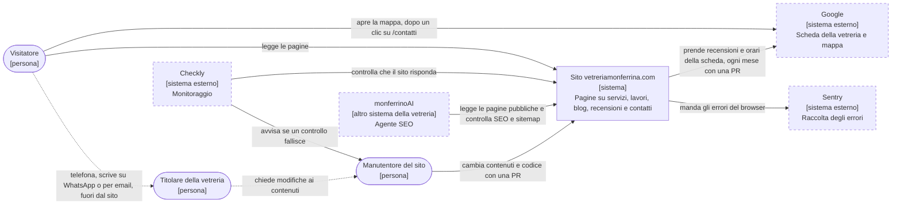
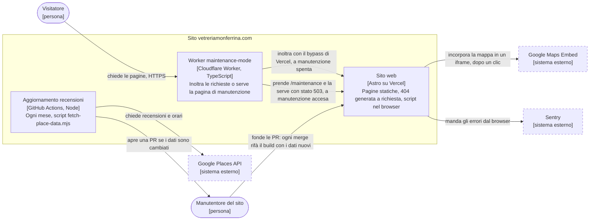
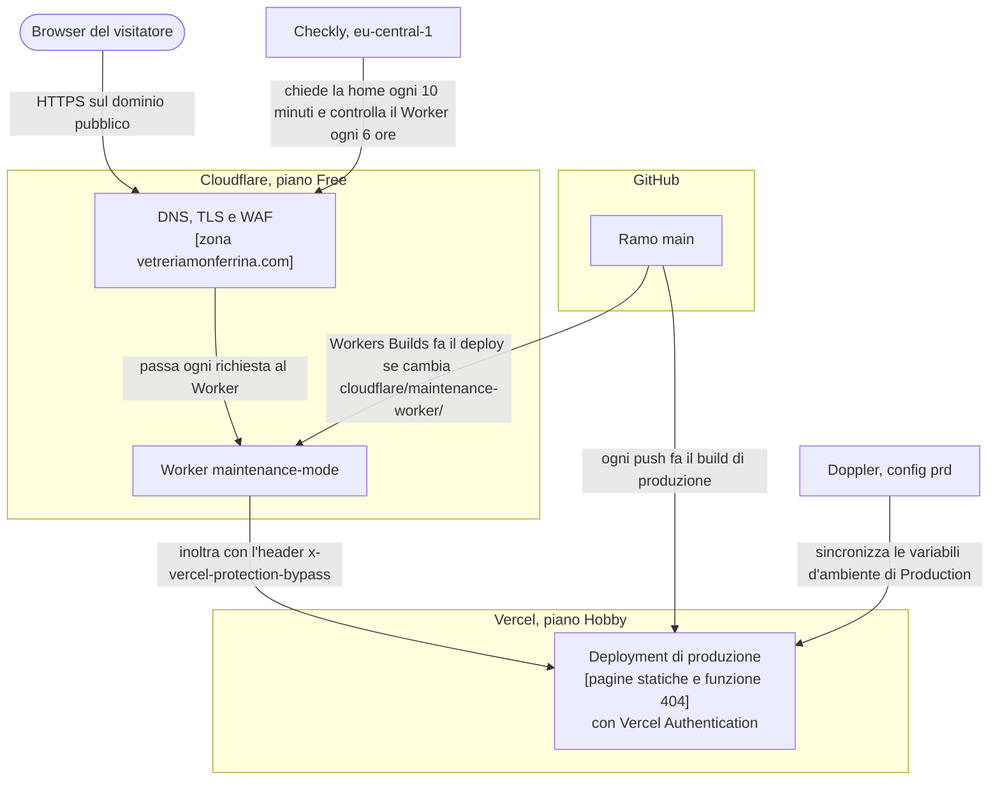
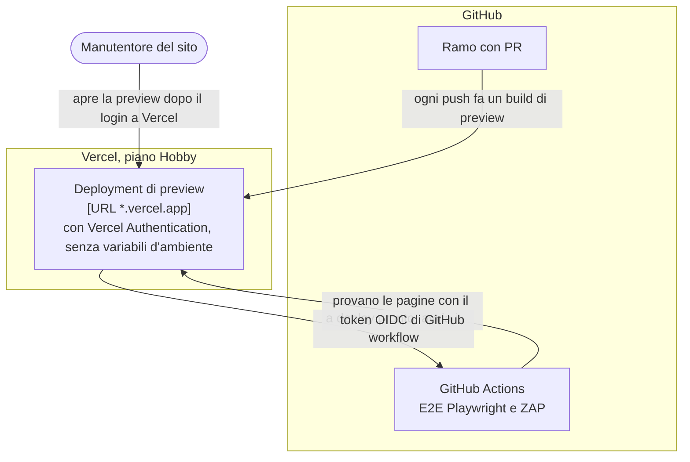

# Architettura del sito

Come è fatto il sito e perché. I diagrammi seguono il [modello C4](https://c4model.com/) (contesto, container, deploy), le sezioni il minimo che [arc42](https://faq.arc42.org/questions/B-4/) chiede per un sistema piccolo. I dettagli di configurazione stanno nel [README](../README.md); qui ci sono i rimandi.

## 1. Obiettivi di qualità

Ogni obiettivo è uno scenario: cosa succede e chi se ne accorge.

| Obiettivo                     | Scenario                                                                                                                                                                                                                                                                                                                                                                      | Cosa lo fa rispettare                                                                                                                                                 |
| ----------------------------- | ----------------------------------------------------------------------------------------------------------------------------------------------------------------------------------------------------------------------------------------------------------------------------------------------------------------------------------------------------------------------------- | --------------------------------------------------------------------------------------------------------------------------------------------------------------------- |
| Sicurezza                     | Una modifica aggiunge uno script inline senza hash: il browser lo blocca, e il test della CSP sulla preview fallisce prima del merge. Chi chiama Vercel direttamente, saltando Cloudflare, riceve il login.                                                                                                                                                                   | CSP senza `'unsafe-inline'` ([`CLAUDE.md`](../CLAUDE.md), sezione CSP), `tests/e2e/csp.spec.ts`, Vercel Authentication ([README](../README.md#vercel-authentication)) |
| Dati minimi                   | Il visitatore non inserisce dati: non ci sono moduli né API, e l'unica pagina generata a richiesta è la 404. Ai fornitori arrivano solo i dati tecnici elencati nella mappa dei dati (IP a rete e hosting, errori a Sentry senza IP); la mappa di Google si carica solo dopo un clic.                                                                                         | [`docs/mappa-dati.md`](mappa-dati.md), con i comandi per ricontrollarla (sezione 5)                                                                                   |
| Disponibilità e controllo     | Il sito o il Worker smettono di rispondere: il controllo della home, ogni 10 minuti, passa da tutti e due e avvisa il manutentore. La manutenzione resta accesa per sbaglio, o il Worker smette di togliere gli header `x-vercel-*` dei visitatori: lo trovano i controlli sugli header, ogni 6 ore. Una manutenzione si accende dalla dashboard di Cloudflare, senza deploy. | Monitor Checkly ([README](../README.md#checkly)), [README del Worker](../cloudflare/maintenance-worker/README.md)                                                     |
| Spesa minima                  | Hosting, rete e monitoraggio stanno nei piani gratuiti; l'unica spesa è il credito prepagato degli agenti Gemini che rivedono le PR, con un tetto mensile. I rischi dei piani gratuiti sono scritti e accettati.                                                                                                                                                              | Vercel Hobby, Cloudflare Free, Checkly su una sola location; rischi in [ADR-0003](adr/0003-via-modulo-e-meteo-resta-su-vercel.md)                                     |
| Gestibile da una persona sola | Una dipendenza ha una vulnerabilità: Dependabot apre la PR, e le minor e patch si fondono da sole quando i check sono verdi. Nessuno pusha su `main`: ogni modifica passa da una PR con i check obbligatori.                                                                                                                                                                  | Ruleset `protect-main`, [CONTRIBUTING](../CONTRIBUTING.md), workflow in [README](../README.md#cicd)                                                                   |

## 2. Contesto

Chi usa il sito e con quali sistemi parla. Il diagramma non nomina le tecnologie del sito. Il manutentore è chi sviluppa e gestisce il sito.

Legenda: forma arrotondata = persona; rettangolo continuo = il sistema descritto; rettangolo tratteggiato = sistema esterno, o altro sistema fuori da questo; freccia continua = passa dal sito o da un sistema; freccia tratteggiata = tra persone, fuori dal sito.

Il titolare non usa il sito per lavorare: i clienti lo contattano con telefono, WhatsApp ed email, che il sito mostra ([`src/data/contatti.ts`](../src/data/contatti.ts)). monferrinoAI è un sistema separato, con una sua repo nell'organizzazione GitHub `Monferrina`.

## 3. Container

Le parti del sito che girano.

Legenda: come nel contesto; il riquadro contiene i container del sito.

Recensioni e orari sono file JSON nella repo (`src/data/reviews.json`, `src/data/opening-hours.json`) che il build legge: non c'è un database ([`docs/mappa-dati.md`](mappa-dati.md)). La 404 è una funzione di Vercel dello stesso build, renderizzata a richiesta perché abbia la CSP con gli hash. Gli script nel browser sono il tema, il chatbot (un flusso fisso in `src/data/chatbot-flow.json`, senza servizi esterni) e Sentry.

## 4. Deploy

Due ambienti. In produzione le richieste passano da Cloudflare e dal Worker, la preview no ([ADR-0003](adr/0003-via-modulo-e-meteo-resta-su-vercel.md), punto 6, che conferma l'ADR-0002 su questo).

### Produzione

Legenda: un riquadro raggruppa le parti che stanno presso lo stesso fornitore; un rettangolo fuori dai riquadri è un servizio esterno usato da solo; forma arrotondata = persona o browser.

La configurazione di zona (DNS, TLS, WAF, cache) è nella tabella del [README](../README.md#cloudflare). Chi raggiunge Vercel senza passare dal Worker riceve il login di Vercel ([README](../README.md#vercel-authentication)). I segreti del Worker sono fuori dalla sincronizzazione di Doppler ([README del Worker](../cloudflare/maintenance-worker/README.md)).

### Preview

Legenda: come in produzione.

La preview non ha Cloudflare né il Worker davanti: prova il frontend, mentre il Worker si prova con i suoi test unitari (`tests/unit/maintenance-worker.test.ts`, nella CI di ogni PR) e, dopo il merge, in produzione con Checkly. E2E e ZAP entrano con il token OIDC accettato dai Trusted Sources di Vercel, solo sulle preview. Quali check bloccano il merge sta in [CONTRIBUTING](../CONTRIBUTING.md).

## 5. Decisioni e rischi

Le decisioni stanno nel [registro degli ADR](adr/README.md). I rischi accettati, come i termini d'uso del piano Hobby di Vercel, sono nell'[ADR-0003](adr/0003-via-modulo-e-meteo-resta-su-vercel.md).
